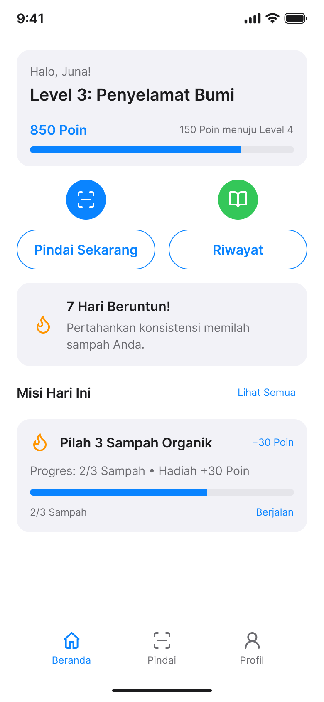
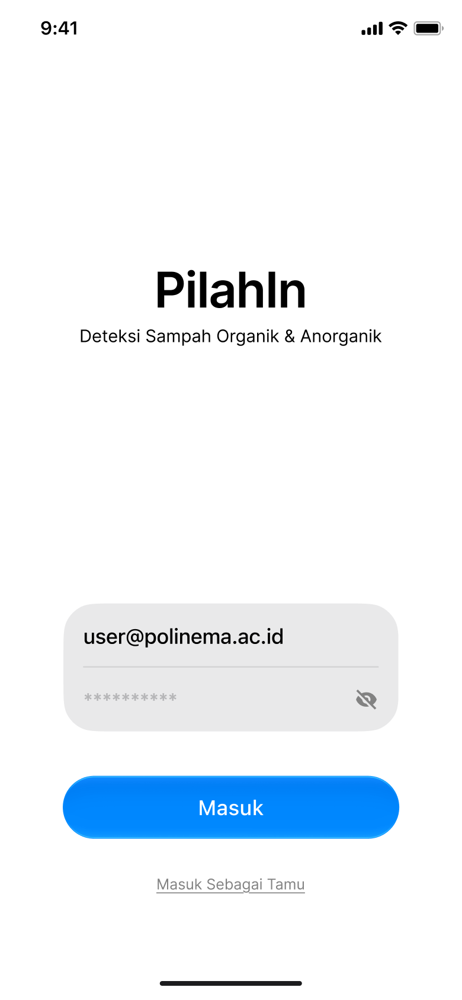
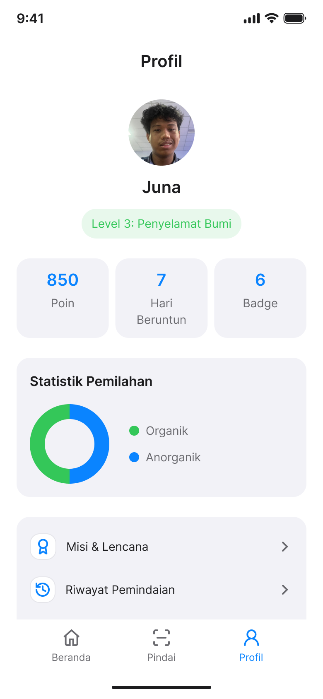

# UI Design PilahIn

Link Figma: https://www.figma.com/design/xxxxx

### Layar Utama

| No | Layar | File | Preview |
|:--:|-------|------|:-------:|
| 1 | Beranda | [`Beranda.png`](./Beranda.png) |  |
| 2 | Hasil Pemindaian (Organik) | [`Hasil Pemindaian - Organik.png`](./Hasil%20Pemindaian%20-%20Organik.png) |  |
| 3 | Koleksi Badge | [`Koleksi Badge.png`](./Koleksi%20Badge.png) |  |
| 4 | Login | [`Login.png`](./Login.png) |  |
| 5 | Misi & Lencana | [`Misi & Lencana.png`](./Misi%20%26%20Lencana.png) |  |
| 6 | Panduan Pengelolaan | [`Panduan Pengelolaan.png`](./Panduan%20Pengelolaan.png) |  |
| 7 | Pemindai Kamera | [`Pemindai Kamera.png`](./Pemindai%20Kamera.png) |  |
| 8 | Profil | [`Profil.png`](./Profil.png) |  |
| 9 | Riwayat Pemindaian | [`Riwayat Pemindaian.png`](./Riwayat%20Pemindaian.png) |  |

### Detail Badge

| No | Layar | File | Preview |
|:--:|-------|------|:-------:|
| 1 | Detail Badge (Terbuka) | [`Terbuka.png`](./Koleksi%20Badge/Detail%20Badge/Terbuka.png) |  |
| 2 | Detail Badge (Terkunci) | [`Terkunci.png`](./Koleksi%20Badge/Detail%20Badge/Terkunci.png) |  |

